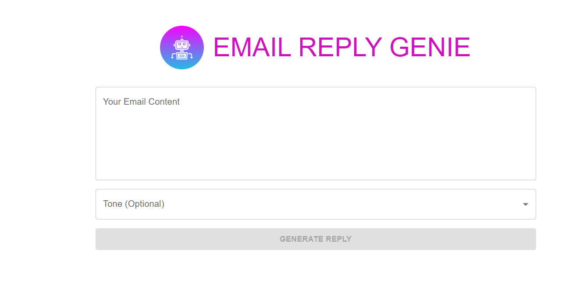
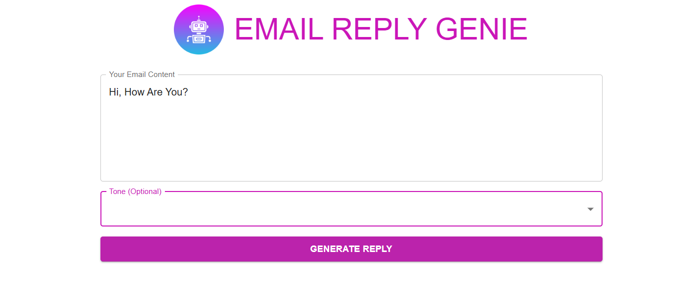
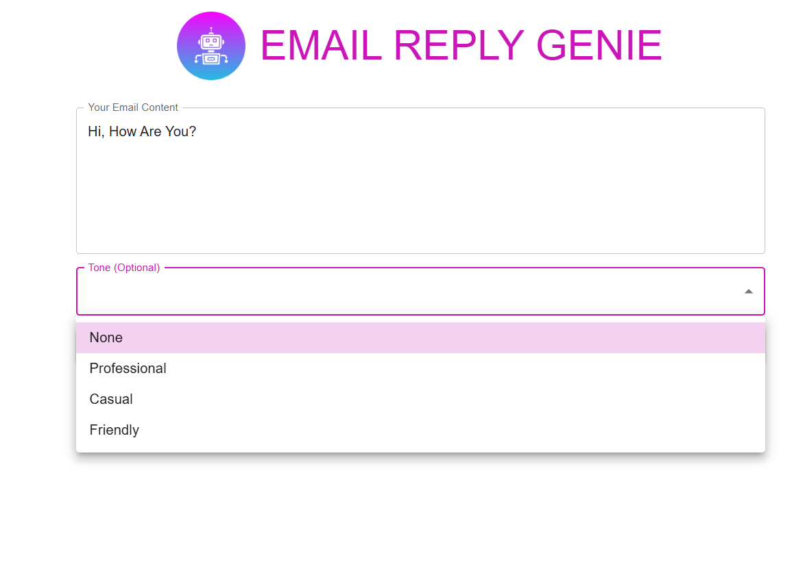
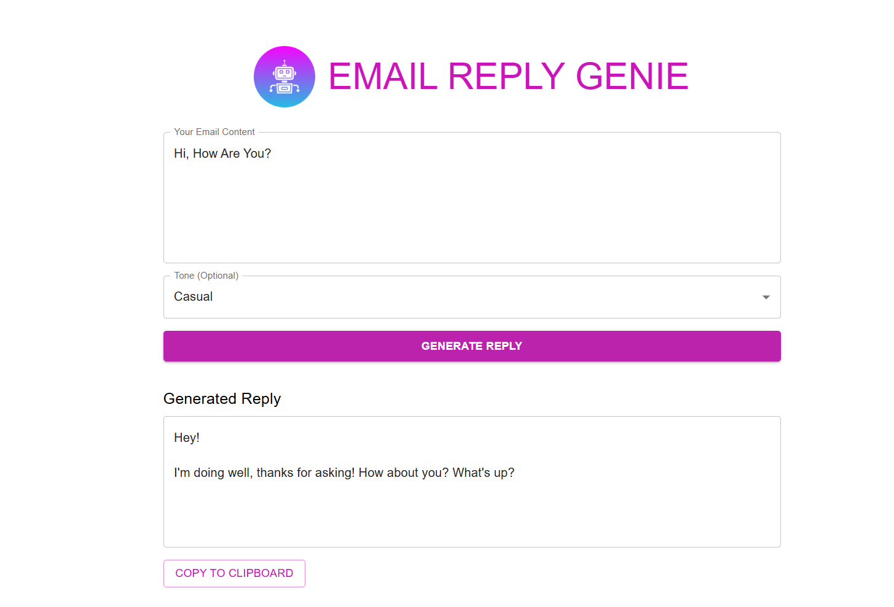
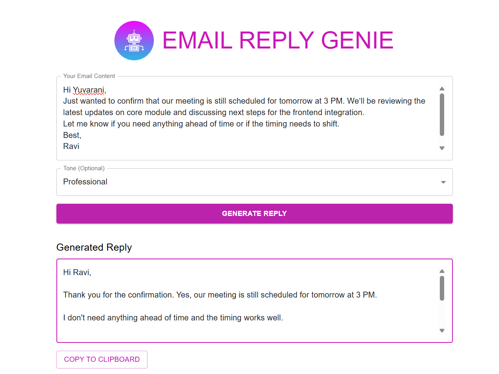

# Email Reply Genie

**Generate a draft email reply from email text and an optional tone.**

Email Reply Genie pairs a React and Material UI interface with a Java Spring Boot API. The backend sends the supplied email content and optional tone to the configured Google Gemini API and returns the generated reply as text.

## Features

- Enter or paste the email you want to answer.
- Choose an optional professional, casual, or friendly tone.
- Generate a reply and copy it to the clipboard.
- View the flow in the included screenshots:

| Home | Enter email | Choose tone |
| --- | --- | --- |
|  |  |  |

| Generated reply | Copy reply |
| --- | --- |
|  |  |

## Architecture

```text
React + Vite UI  ── POST /api/email/generate ──>  Spring Boot API  ──>  Gemini API
```

The API accepts JSON with `emailContent` and an optional `tone`:

```json
{
  "emailContent": "Could you share an update on the project?",
  "tone": "professional"
}
```

The endpoint is `POST /api/email/generate`. The current UI sends requests to `http://localhost:8080`.

## Technology

- **Backend:** Java 21, Spring Boot 3, Spring Web / WebFlux, WebClient
- **Frontend:** React 19, Vite 7, Material UI, Axios
- **AI integration:** Google Gemini API

## Run locally

Prerequisites: Java 21, Node.js, and npm.

### 1. Configure the backend

Set the Gemini API endpoint and API key as environment variables. Keep the API key private; do not commit it.

```powershell
$env:GEMINI_API_URL = "your Gemini API endpoint"
$env:GEMINI_API_KEY = "your API key"
cd emailreplygenie
.\mvnw.cmd spring-boot:run
```

The backend starts on Spring Boot’s default port `8080`.

### 2. Start the frontend

In a second terminal:

```powershell
cd emailreplygenie-ui
npm install
npm run dev
```

Open the Vite URL printed in the terminal (typically `http://localhost:5173`). The backend currently allows the local Vite origin for cross-origin requests.

On macOS or Linux, use `./mvnw` instead of `.\mvnw.cmd`.

## Build and checks

```powershell
cd emailreplygenie-ui
npm run lint
npm run build
```

In the backend directory, run `.\mvnw.cmd test`.

## Repository layout

- `emailreplygenie/` — Spring Boot API.
- `emailreplygenie-ui/` — React and Vite frontend.
- `assets/` — screenshots used in this README.

## Known limitations

- The frontend currently targets a local backend URL; configure it for your deployment before hosting the UI elsewhere.
- Review generated text before sending it. Do not submit confidential or sensitive email content unless your privacy requirements allow it.
- Add production-ready request validation, error handling, and deployment configuration before exposing the API publicly.

## Links

- [GitHub repository](https://github.com/yuvaranianbu27/Email-Reply-Genie)
- [LinkedIn](https://www.linkedin.com/in/yuvaranianbu)
- [Email](mailto:yuvaranianbu27@gmail.com)
